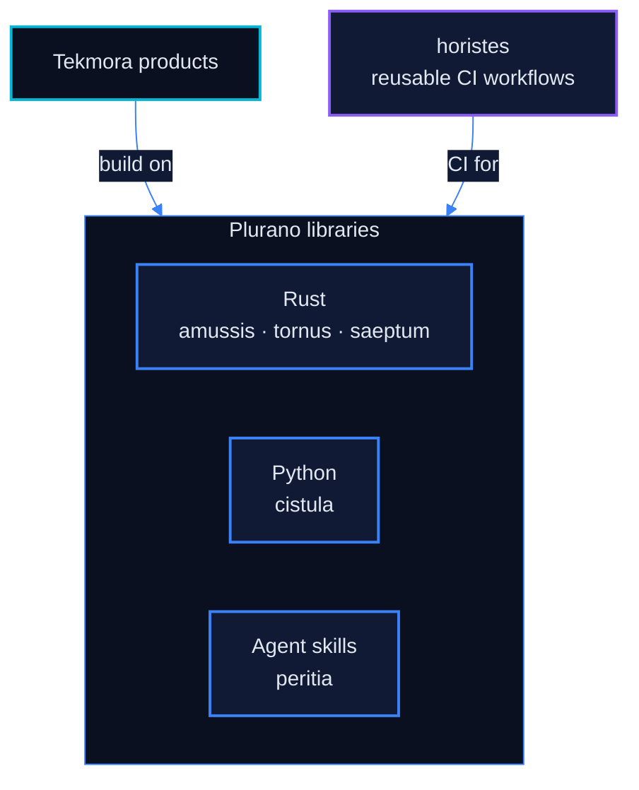

<!-- markdownlint-disable MD013 MD033 MD036 MD041 -->

  

  <!-- badge block: one group, fixed order -->
  <!-- 4 standards -->
  
  <!-- 5 licence -->
  
  <!-- 6 support -->
  
  

  **Many components, one craft**

  *Shared libraries and frameworks, written once and used by every project in the family*

Plurano holds the shared libraries and frameworks of one family of projects.
Each is written once and used by every project that needs it. The products built
on them live at [Tekmora](https://github.com/tekmora).

## Name

Plurano is from Latin *plures*, many, as in "out of many, one". Said plu-RAH-no.

Each library carries a Latin or Greek name for a craftsman's tool or an idea of
its work; the table below gives each name's meaning and pronunciation. Tekmora,
the home of the products, is from Greek *tekmerion*, decisive proof, said
tek-MOH-ra.

## Libraries

| Library | What it is | Name |
| :--- | :--- | :--- |
| [amussis](https://github.com/plurano/amussis) | Shared Rust crates of the family, with a Go binding | Latin *amussis*, the mason's levelling board; ah-MOOS-sis |
| [tornus](https://github.com/plurano/tornus) | Geometric modelling kernel for CAD, in Rust | Latin *tornus*, a lathe; TOR-noos |
| [saeptum](https://github.com/plurano/saeptum) | Bounded job sandbox library in Rust (microVM and Wasm capsules, Linux sandboxed runner), with a Go binding | Latin *saeptum*, an enclosure; SYEP-tum |
| [cistula](https://github.com/plurano/cistula) | Shared Python helpers of the family | Latin *cistula*, a small chest for tools; KIS-tu-la |
| [horistes](https://github.com/plurano/horistes) | Reusable CI workflows and templates of the family | Greek *horistes*, the boundary commissioner; ho-RIS-tees |
| [peritia](https://github.com/plurano/peritia) | One library of expert agent skills, adapted from upstream with pin, licence and credit per skill | Latin *peritia*, expertise; PEH-ree-tee-ah |

Each repository lists its releases on its own releases page.

## At a glance

## Contribute

Each repository has its own contributing guide. A repository without one uses
the default files kept here:
[code of conduct](https://github.com/plurano/.github/blob/main/CODE_OF_CONDUCT.md),
[contributing guide](https://github.com/plurano/.github/blob/main/CONTRIBUTING.md)
and [security policy](https://github.com/plurano/.github/blob/main/SECURITY.md).

## Support

Questions, ideas and defects go to the issues of the repository they are
about, and security reports to a private advisory, as its security policy
asks.

The maintainer's work on the Plurano libraries can be sponsored on
[GitHub Sponsors](https://github.com/sponsors/lusoris),
[Ko-fi](https://ko-fi.com/lusoris) or
[Patreon](https://www.patreon.com/Lusoris), any amount; sponsors are thanked,
and no support or priority is sold.

## Licence

The libraries are licensed under the European Union Public Licence 1.2; a part
taken from upstream or built into a shipped file keeps its own licence, which
the licence section of that library names. This profile and the shared
community files are licensed under the
[EUPL-1.2](https://github.com/plurano/.github/blob/main/LICENSE) as well.
